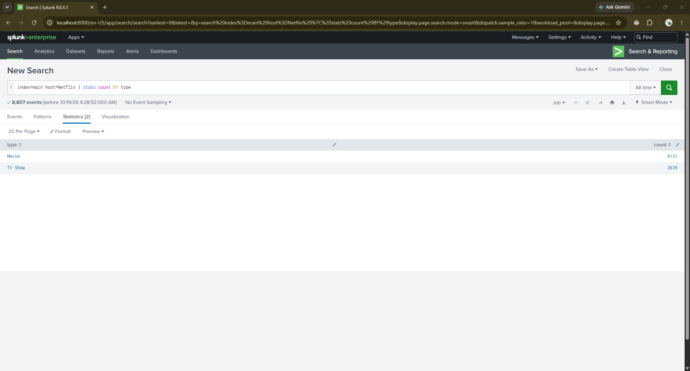
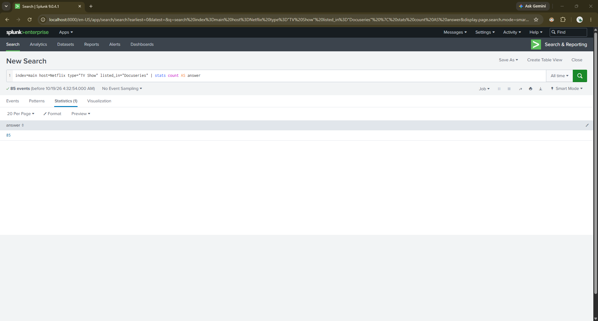
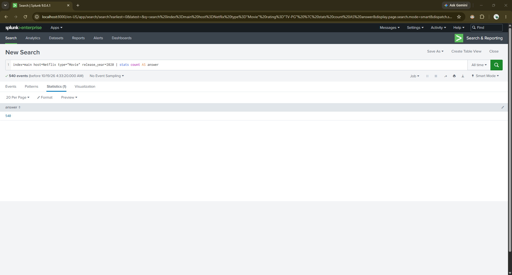
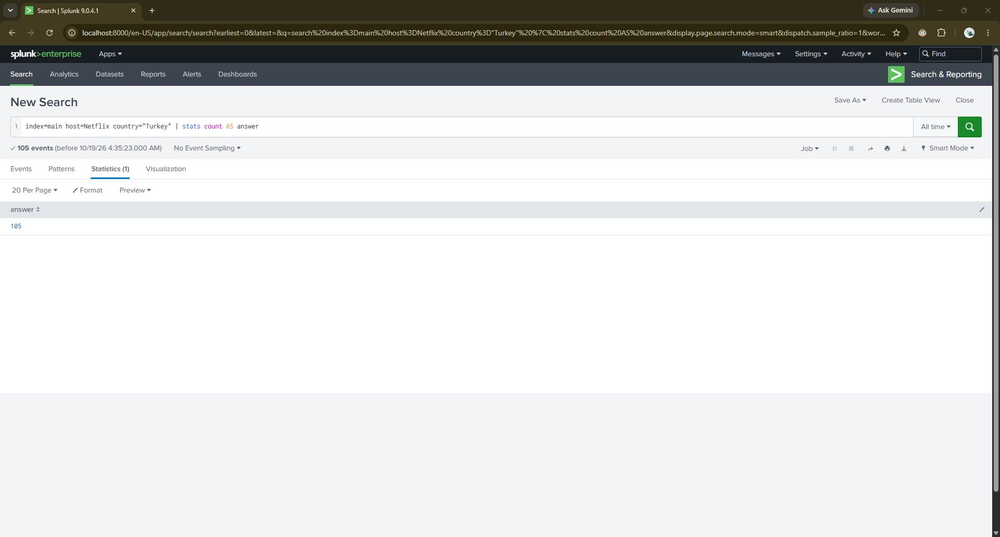

# My Splunk SIEM Lab Project

## About this project

I worked on the [CodePath Splunk Lab](https://github.com/codepath/opencyber-splunk-lab) to learn how to search and understand data in Splunk. I ran the lab with Docker and practiced writing SPL searches.

I started with Netflix data to get comfortable filtering records and finding answers. I learned how each filter changes the results instead of just copying searches.

## Tools I used

- Splunk Enterprise
- Docker
- Splunk Search Processing Language (SPL)

## What I did

I searched the Netflix data and found **8,807 titles**: **6,131 movies** and **2,676 TV shows**.

```spl
index=main host=Netflix | stats count BY type
```

### Finding Docuseries

I filtered for TV shows listed only as Docuseries and found **85**.

```spl
index=main host=Netflix type="TV Show" listed_in="Docuseries" | stats count AS answer
```

### Finding TV-PG movies

I searched for movies rated TV-PG and found **540**.

```spl
index=main host=Netflix type="Movie" rating="TV-PG" | stats count AS answer
```

### Looking for movies released in 2020

I searched for movies released in 2020. I recorded **517** during the lab, but I still need a screenshot showing the completed result.

```spl
index=main host=Netflix type="Movie" release_year=2020 | stats count AS answer
```

### Finding PG-13 Action & Adventure movies

I found **23** movies matching the PG-13 rating and the exact Action & Adventure listing.

```spl
index=main host=Netflix type="Movie" rating="PG-13" listed_in="Action & Adventure" | stats count AS answer
```

### Finding titles from Turkey

I searched for titles with Turkey as their country and found **105**.

```spl
index=main host=Netflix country="Turkey" | stats count AS answer
```

### Finding the year with the most G-rated movies

I grouped G-rated movies by year, counted them, and sorted the results. **2009** was first with **4 movies**.

```spl
index=main host=Netflix type="Movie" rating="G" | stats count BY release_year | sort - count | head 1
```


## Screenshots from my lab

These are screenshots I took while running searches in Splunk. I included the searches and results so people can see what I worked on.

### Looking at the Netflix dataset



### Finding Docuseries



### Finding TV-PG movies


### Searching for 2020 movies

This screenshot shows the search I entered, but the result on screen had not updated yet. My recorded result was 517.



### Finding PG-13 Action & Adventure movies


### Finding titles from Turkey



### Finding the year with the most G-rated movies


## What I learned

At first I didn't really understand what the filters meant. After trying different searches, I started to understand that `index` tells Splunk where to look, filters narrow the results, and the pipe (`|`) lets me count or sort what I found.

I also learned why searching logs matters in cybersecurity. It helps me find useful information in a lot of data.

## Credit

The lab and sample data are from [CodePath's open source Splunk Lab](https://github.com/codepath/opencyber-splunk-lab). This README documents my practice and results.
